<p align="center">
  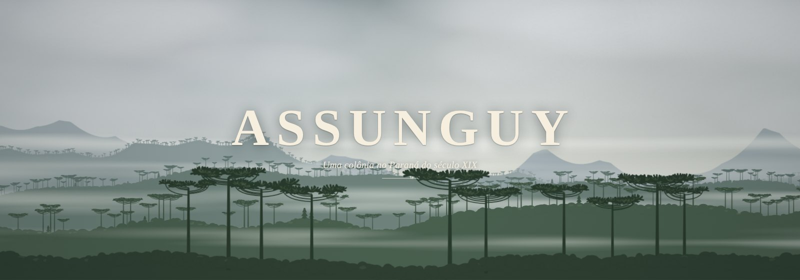
</p>

# Assunguy

Assunguy é um jogo de gestão de colônia ambientado no Paraná do século XIX. Você chega à beira do rio com dez famílias, uma verba curta da província e um prazo. Abre ruas, distribui lotes, planta, monta oficinas, cobra impostos e tenta escoar a produção por caminhos ruins até Iguape e Curitiba. Se a colônia crescer, vira freguesia, depois vila, e no fim disputa a ferrovia com as colônias vizinhas.

O jogo corre em turnos de uma estação. A cada estação as famílias trabalham, colhem, vendem o que sobra e reagem ao que você decidiu. O conselheiro, que você batiza no começo, lê a situação e sugere o próximo passo, sempre com o motivo.

- Mapa isométrico, com prédios, árvores, gente e transporte desenhados por código.
- Feito para o celular primeiro, mas joga bem no computador.
- Português e inglês, trocáveis a qualquer momento.
- Roda inteiro no navegador, sem servidor. Os jogos ficam salvos no próprio aparelho e podem ser exportados para um arquivo.

Versão atual: **1.0.0-beta.7**. Para jogar, abra **[phenricor.github.io/assunguy](https://phenricor.github.io/assunguy/)** no navegador do celular ou do computador. Se preferir jogar sem internet, baixe o arquivo `.html` da [última release](https://github.com/phenricor/assunguy/releases) e abra no navegador.

## Colônia do Assunguy

A Colônia do Assunguy foi criada pelo governo imperial em 1860, a cerca de 100 km ao norte de Curitiba, no vale do Ribeira. Era uma colônia oficial, com diretor, lotes medidos e a promessa de estrada, escola e igreja. Recebeu alemães, ingleses, franceses, suíços e italianos, e depois poloneses, espanhóis e dinamarqueses, entre outros. Em 1868 chegou um grupo grande de ingleses e irlandeses.

O lugar era difícil. O solo era bom, mas o relevo era íngreme e limitava as lavouras. Os caminhos eram ruins, o frete dependia de tropas de mulas e custava caro, e a colônia vivia isolada. Comia-se feijão e farinha. Plantava-se milho, criavam-se porcos e mulas, e o que se vendia era rapadura e melado. A escola e a igreja prometidas demoraram a sair, e muitas famílias desistiram. Em 1874 os jornais da Corte noticiaram a partida de 46 colonos ingleses que queriam voltar para casa.

Mesmo assim, o povoado ficou. Virou freguesia em 1872, vila em 1882, passou a se chamar Serro Azul em 1885 e foi elevado a cidade em 1897. A grafia mudou para Cerro Azul em 1929, nome do município até hoje.

O jogo parte dessa história e a trata como ficção. Os marcos da colônia (freguesia, vila, cidade) seguem os da colônia real, os produtos e os caminhos são os da época, e os Kaingang, que já viviam no pinheiral, aparecem no mapa e nos acontecimentos. Não há escravidão no jogo. O resto é invenção: a colônia que você dirige pode dar certo onde a real sofreu.

Fontes: [IBGE, histórico de Cerro Azul](https://biblioteca.ibge.gov.br/visualizacao/dtb/parana/cerroazul.pdf); [Revista Travessia, sobre os britânicos no Assunguy](https://travessia.emnuvens.com.br/travessia/article/download/1782/1443/4190); [Gazeta do Povo, "Os 46 desertores ingleses"](https://www.gazetadopovo.com.br/vida-e-cidadania/colunistas/dante-mendonca/os-46-desertores-ingleses-erf5k2jaarz9lap05d76iklz1/).

## Mecânicas

<table>
<tr>
<td width="96">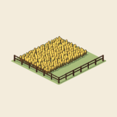</td>
<td><b>Estações e anos.</b> Cada turno é uma estação, e quatro estações fazem um ano. O clima muda a colheita, os preços mudam o que vale a pena produzir, e o relatório da estação mostra o que entrou, o que saiu e o que ficou parado.</td>
</tr>
<tr>
<td width="96">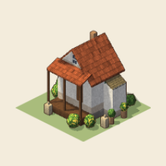</td>
<td><b>Famílias e satisfação.</b> Cada família precisa de casa e de trabalho. A satisfação depende da moradia, dos serviços por perto, dos impostos e das leis, e é uma das exigências de cada marco.</td>
</tr>
<tr>
<td width="96">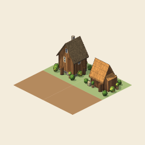</td>
<td><b>Ruas, lotes e terras.</b> Tudo se constrói em lotes ao longo das ruas. A colônia começa numa terra e cresce anexando as vizinhas, o que custa influência e dinheiro. Cada terra tem o seu solo, a sua mata e os seus recursos.</td>
</tr>
<tr>
<td width="96">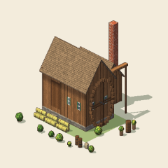</td>
<td><b>Produção.</b> Plantações e criações dão a matéria-prima. As oficinas transformam o que há por perto, e as famílias decidem sozinhas o que processar conforme o preço: mandioca vira farinha, cana vira rapadura ou aguardente, erva vira mate.</td>
</tr>
<tr>
<td width="96">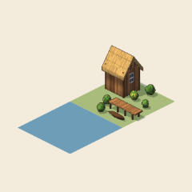</td>
<td><b>Escoamento.</b> O que a colônia não consome precisa sair. Cais, porto e pouso são as portas para fora, venda e embarcadouro recolhem a produção longe do comércio, e tropas, carroças, canoas e vapores levam a carga. Cada prédio de transporte já vem com o primeiro veículo; quando enche, outro veículo ou um nível a mais abrem espaço. A tarifa é sua: a preço de custo o caixa empata, com margem ganha, mas os produtores passam a preferir levar a pé.</td>
</tr>
<tr>
<td width="96">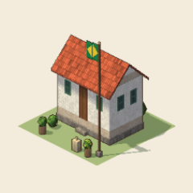</td>
<td><b>Governo.</b> Três impostos (dízimo, dízimo de exportação e licença de negócio), oito leis, como feira semanal, mutirão de obras e escola obrigatória, e oito grandes obras, do telégrafo à serraria a vapor.</td>
</tr>
<tr>
<td width="96">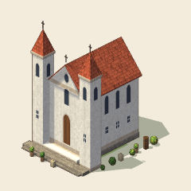</td>
<td><b>Níveis e marcos.</b> A colônia tem 12 níveis, que liberam novas culturas, oficinas e serviços. Os marcos vêm com prazo da província. A freguesia pede 90 famílias, satisfação 50, capela, escola e diretoria em 32 estações. A vila pede 180 famílias, quatro terras e mais serviços.</td>
</tr>
<tr>
<td width="96"></td>
<td><b>Conselheiro.</b> Sugere o que mais pesa agora, explica por quê e faz a ação com um toque. Não decide por você.</td>
</tr>
<tr>
<td width="96">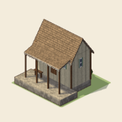</td>
<td><b>A corrida da ferrovia.</b> No fim do jogo a ferrovia chega à região e as colônias rivais disputam o ramal. Ganha quem tiver estação, trilhos e uma produção que valha o frete.</td>
</tr>
</table>

### Categorias de construção

| Categoria | O que entra |
|---|---|
| Ruas | Ruas, que abrem os lotes, e trilhos na corrida da ferrovia |
| Moradia | Rancho, casa, casa caiada e sobrado |
| Serviços | Capela, igreja matriz, escola, botica, Santa Casa, teatro, poço, chafariz, diretoria, câmara, cadeia e bombeiros |
| Comércio | Comércio e mercado |
| Transporte | Venda, embarcadouro, cais, porto, pouso, depósito de lenha, estação e parada |
| Plantações | Milho, feijão, mandioca, arroz, trigo, cana, fumo, algodão e café |
| Criação | Curral, chiqueiro, pesqueiro, coleta de pinhão e erval |
| Extração | Serraria, olaria e mina |
| Oficinas | Monjolo, casa de farinha, salga, moinho, engenho, alambique, barbaquá, paiol de fumo, curtume, carpintaria, tanoaria, ferraria, terreiro de café, tear e sapataria |

## Galeria

<p align="center">
  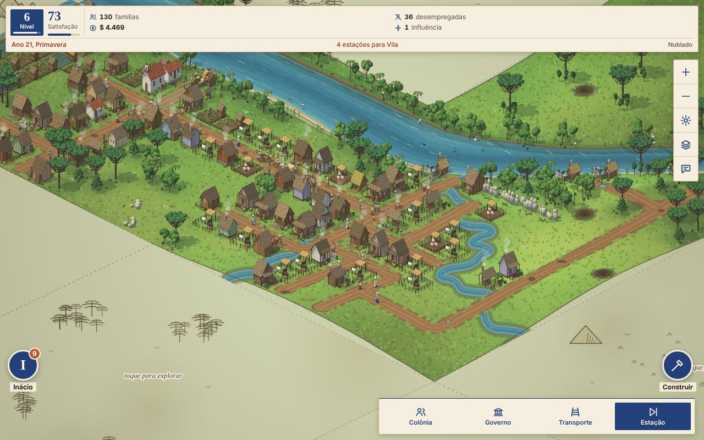
  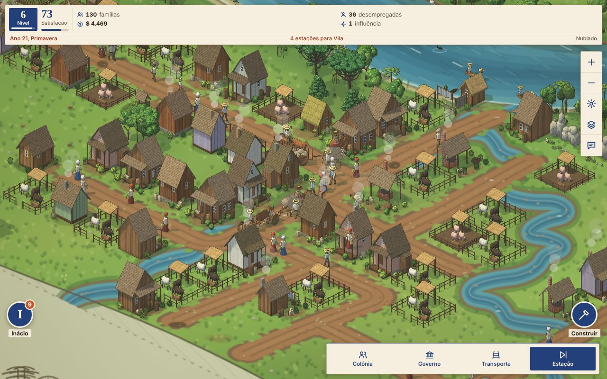
</p>
<p align="center">
  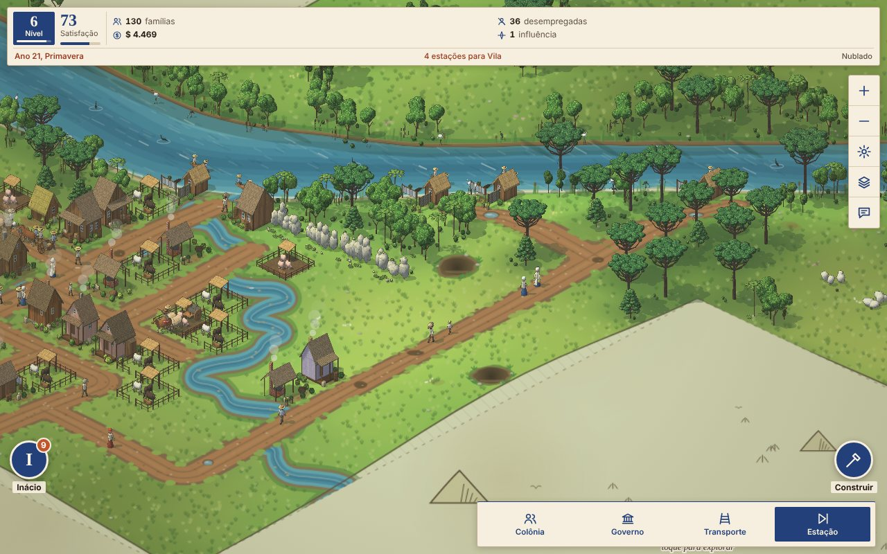
  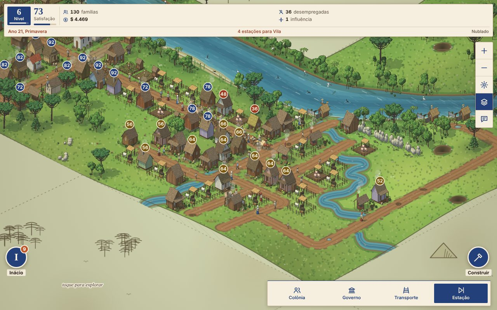
</p>
<p align="center">
  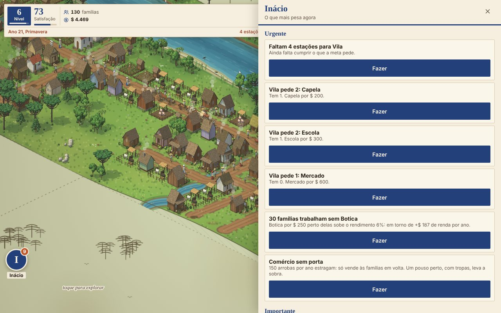
  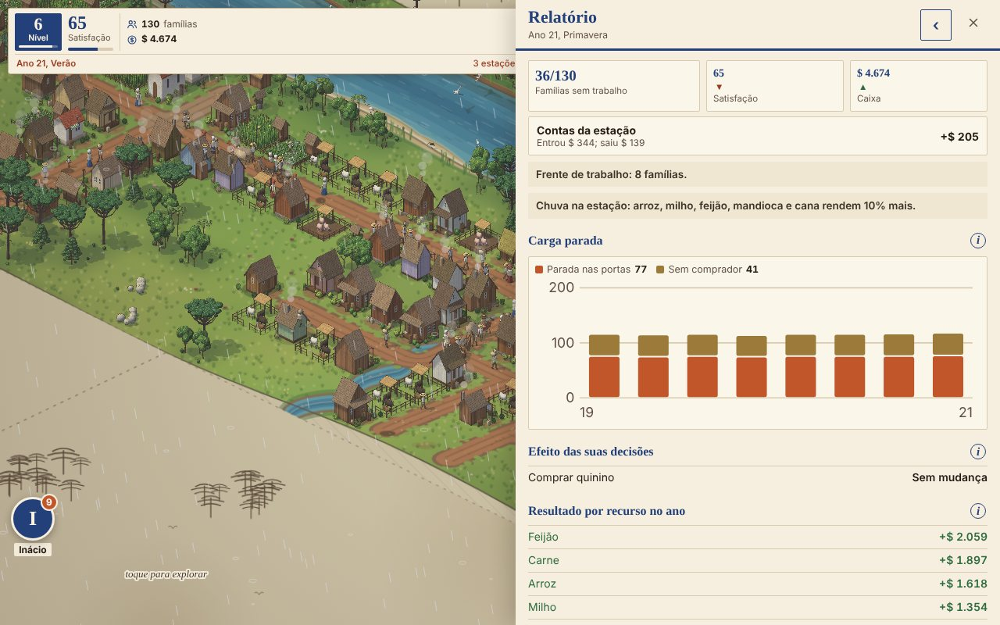
</p>
<p align="center">
  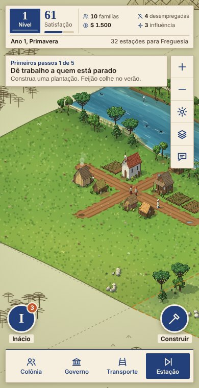
</p>

### Edifícios

Todos os prédios saem do mesmo gerador de sprites: modelos 3D simples, iluminados do mesmo lado e projetados em isometria. Cada um tem níveis e variações.

<p align="center">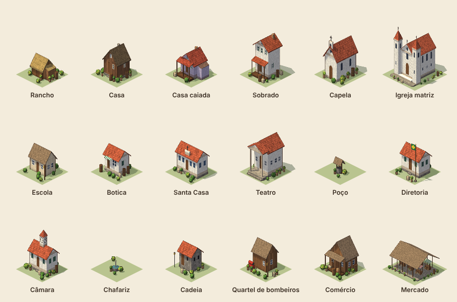</p>
<p align="center">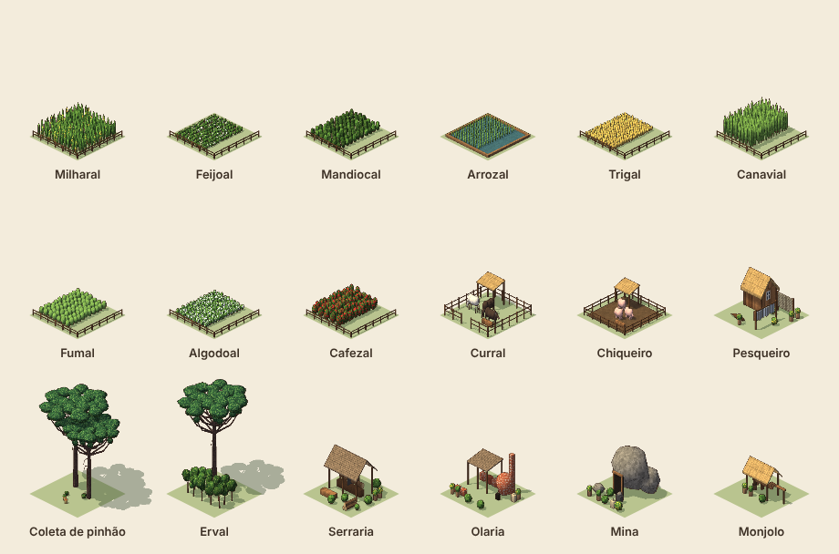</p>
<p align="center">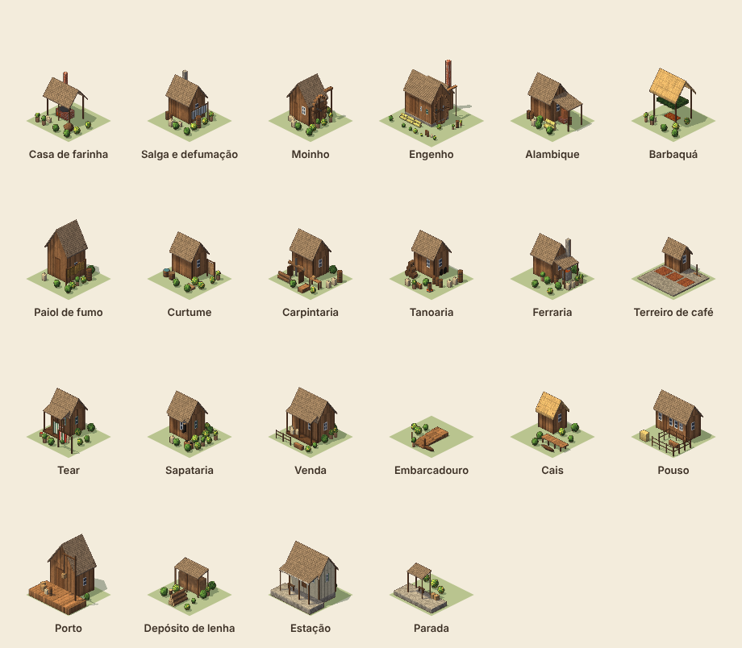</p>

## Manutenção e licença

Mantido por [Paullo](https://github.com/phenricor). Sugestões e problemas podem vir pelas issues do repositório ou pelo botão de comentário dentro do jogo, abaixo do botão de camadas.

### Estrutura

```
packages/
  data/     tabelas de conteúdo e equilíbrio (bens, prédios, veículos, níveis, leis, biomas)
  i18n/     textos em pt-BR e en; o código não guarda texto de tela
  sim/      as regras, em TypeScript puro e determinístico, sem DOM
apps/
  game/     o jogo: Vite, gera um único arquivo HTML
    src/render/  o renderizador do mapa e o gerador de sprites
    src/ui/      menus, painéis e telas
tools/
  bot/      o jogador robô e os relatórios de equilíbrio
  text/     scripts que escrevem os textos nos dois idiomas
docs/       notas do jogo, do equilíbrio e da revisão de interface
```

Algumas regras do código: identificadores e comentários em inglês, texto de tela só nos catálogos de `packages/i18n`, e nenhum `Math.random` na simulação, porque todo sorteio vem de uma semente guardada no estado. A exceção ao inglês é `apps/game/src/render/`, que veio do protótipo e continua em português.

### Comandos

```
pnpm install
pnpm test          # testes de unidade e golden
pnpm typecheck
pnpm balance       # partidas do robô e relatório de equilíbrio
cd apps/game && npx vite build   # o jogo, em dist/index.html
```

### Licença

O jogo é distribuído sob a [PolyForm Noncommercial 1.0.0](LICENSE). Pode ser usado, estudado, modificado e compartilhado para fins não comerciais. O uso comercial depende de autorização do autor.
